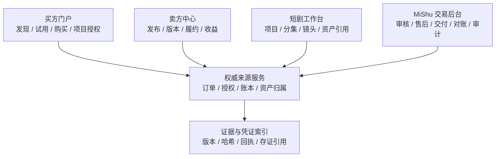

# MiShu AI 短剧数字资产交易平台调研与改造方案

调研日期：2026-11-04。版本：方案研究版 v1。证据范围：官方许可、帮助中心、产品说明和公开入口；本报告没有把公开网页阅读写成平台实操。浏览器实际操作仍受当前会话的 CUA/Chrome 授权限制，本报告没有 H（hands-on）级记录。

本报告承接[平台综合调研报告](platform-benchmark-report.md)、[城市数据交易所比较](data-exchange-city-comparison.md)和[岗位工作区改造计划](role-workspaces-plan.md)。城市数据交易所继续作为合规、登记、交付、结算、凭证和争议处理的辅助参考；当前产品主线改为：

> 面向 AI 短剧生产的数字资产交易与授权运营平台。

这里的“资产”不仅是一个下载文件，也包括视频、图片、音乐、音效、字体、模板、LUT、3D 模型、角色、场景、分镜、镜头素材、LoRA、Checkpoint、工作流、提示词和由多个组件组成的素材包。平台卖的是可验证的使用权、交付物和服务结果，不能只卖一个孤立的文件链接。

## 1. 产品重新定义

### 1.1 交易对象

MiShu 需要同时服务三类主体，但三类主体不能共用一套岗位语义：

| 主体               | 目标                                                     | 典型入口             | 不应承担的职责               |
| ------------------ | -------------------------------------------------------- | -------------------- | ---------------------------- |
| 买方组织/短剧团队  | 找到适合项目的资产，完成购买、授权、下载、调用和项目登记 | 市场门户、项目资产库 | 审核卖方材料、修改平台账本   |
| 创作者/卖方/工作室 | 发布资产、说明版本和权利、履约、查看收益与争议           | 卖方中心             | 审批自己的退款或修改历史授权 |
| MiShu 内部员工     | 审核、交付、售后、对账、审计和系统管理                   | 交易管理后台         | 代替买方或卖方持有共享账号   |

当前仓库先建设内部后台和事实投影。买方门户、卖方中心和在线生成工作台应作为后续产品面，共用身份体系但分开业务边界。

### 1.2 交易事实不能只用订单表示

需要分开记录：

```text
asset                  资产身份
asset_version          可下载、可调用或可嵌入的具体版本
asset_component        包内子素材及其依赖
listing                市场展示和售卖页面
license_plan           许可方案与限制
project                买方的短剧项目
episode / shot         分集、镜头和资产使用位置
order                  购买事实
entitlement            买方实际获得的权利
delivery               文件、API、在线运行或结果交付事实
download / invocation  下载或调用事实
usage_registration     资产被哪个项目、分集或镜头使用
refund_request         售后申请与退款理由
copyright_case         侵权投诉、下架和复核
royalty_allocation     创作者、平台和上游权利方的分账事实
```

必须保持以下区别：购买成功不等于下载；下载不等于项目使用；项目使用不等于可以再分发原始素材；商品下架不自动抹除历史授权；退款不删除历史订单、账本或证据。

### 1.3 交易完成的判断

对于数字资产，订单完成至少包含四个可独立验证的结果：

1. 付款或积分托管已由权威来源记录；
2. 许可方案和授权快照已生成；
3. 交付文件、调用额度或生成结果已成功提供；
4. 该次使用和分账事实可以在项目、账本和审计中追踪。

`PAID`、`ENTITLEMENT_ISSUED`、`DOWNLOADED`、`REGISTERED_TO_PROJECT` 和 `PROJECT_COMPLETED` 应分别展示。来源执行未知、交付失败、授权过期和侵权下架也必须有独立状态。

## 2. 调研方法和证据边界

### 2.1 调研范围

本轮优先研究与 AI 短剧资产售卖直接相关的四组平台：

1. **数字素材和创作者市场**：Envato Elements/Market、Motion Array、Storyblocks、Adobe Stock、Pond5、Fab、Unity Asset Store、Canva、CapCut。
2. **AI 模型和工作流市场**：LiblibAI、Civitai、TensorArt、SeaArt、Artlist AI Toolkit、Runway、ElevenLabs。
3. **AI 短剧生产工具**：即梦 AI、可灵 AI、海螺 AI，以及 Artlist Studio 等把素材、生成和剪辑串起来的产品。
4. **数字商品和交易基础设施**：Gumroad、Lemon Squeezy、Medusa、Shopify，以及此前报告中的数据市场、支付和结算平台。

### 2.2 证据级别

| 标记 | 定义                                           | 可以支持什么                             | 不能支持什么                           |
| ---- | ---------------------------------------------- | ---------------------------------------- | -------------------------------------- |
| O    | 官方帮助中心、许可条款、开发文档或权限文档     | 文档明确的许可条件、角色、状态和发布流程 | MiShu 当前已验证体验、某个套餐一定可用 |
| P    | 官方产品页、公开产品入口或官方案例             | 产品公开定位和能力方向                   | 后台效率、所有异常路径、企业权限边界   |
| C    | 候选入口或社区资料，尚未独立核验               | 后续实际访问和需求访谈方向               | 任何已确认功能结论                     |
| H    | 在可控测试账号、公开 demo 或沙盒中实际完成操作 | 操作步骤、界面、状态和错误结果           | 推广页没有承诺的隐藏能力               |

本报告目前使用 O、P 和 C；没有 H。需要登录、付费、实名或可能触发真实购买的平台，不使用 MiShu 仓库中的体验账号，不进行真实购买、转账、退款、发布、删除或接受新的法律协议。

## 3. 同类平台比较

### 3.1 数字素材与创作者市场

| 平台 / 证据                                                                                                     | 公开资料中可确认的机制                                                                                     | 可借鉴点                                           | 对 MiShu 的适配和反思                                                                                       |
| --------------------------------------------------------------------------------------------------------------- | ---------------------------------------------------------------------------------------------------------- | -------------------------------------------------- | ----------------------------------------------------------------------------------------------------------- |
| [Envato Elements / O](https://help.elements.envato.com/hc/en-us/articles/360000628966-Envato-Elements-License)  | 下载时生成许可；一个项目对应一个许可；订阅结束后已注册项目可继续使用，新项目需要有效订阅；资产仍归作者所有 | 用“项目授权凭证”把订阅、下载和项目用途连起来       | MiShu 要有 `project_license` 和许可证明；同一素材用于另一部短剧要重新登记，不得只记录一次下载               |
| [Motion Array / O](https://help.motionarray.com/hc/en-us/articles/9442171935005-How-Does-The-License-Work)      | 付费订阅者可以把下载用于多个项目；每个使用者需要席位；取消后停止新作品使用，已完成作品可继续发布           | 把人员席位、项目状态和订阅有效期分开               | 需要区分组织成员、实际使用人和项目状态；不能用“订阅有效”代替授权快照                                        |
| [Storyblocks / O](https://help.storyblocks.com/en/articles/3622218-how-does-licensing-at-storyblocks-work)      | 按个人、小企业和商业计划区分授权范围，内容库与 Maker 等工具结合                                            | 让授权层级与组织规模、发布渠道和使用者范围关联     | 许可方案应结构化保存组织、渠道、地域、期限和项目，而不是一列“商业可用”                                      |
| [Adobe Stock / O](https://stock.adobe.com/license-terms)                                                        | Standard、Extended 等许可类型；授权范围和媒体渠道影响可用方式；同一素材为不同客户使用通常需要分别授权      | 预览、授权级别、媒体渠道和高分辨率交付有明确关系   | MiShu 需要把“可用于短剧成片”与“可再销售原始素材”分开；授权页必须显示限制和来源                              |
| [Pond5 / O](https://www.pond5.com/legal/license)                                                                | 许可按内容和层级定义；视频、音频、素材和实体商品的使用条件不同                                             | 同类资产可以有不同授权层级和渠道限制               | 许可规则应按资产类型和交付方式配置，不能所有文件共用一个 EULA                                               |
| [Fab / O](https://dev.epicgames.com/documentation/en-us/fab/publishing-assets-for-sale-or-free-download-in-fab) | 区分 asset、product、pack、bundle、listing；提交后审核；发布后可更新或下架；退款、下载和收益有独立规则     | 资产内容、销售包装、市场展示、版本和发布状态分开   | 直接对应 MiShu 的 `asset`、`asset_bundle`、`listing`、`asset_version`；下架只能阻止新购买，不能修改历史授权 |
| [Unity Asset Store / O](https://assetstore.unity.com/browse/eula-faq)                                           | 多数第三方资产由发布者拥有；标准 EULA 适用，特殊或受限资产会标注；发布者需要提交并通过审核                 | 发布者、标准 EULA、依赖和受限资产提示清楚          | 资产包必须记录组件、第三方依赖、是否可提取和是否允许再分发；不能把“买了包”写成“拥有所有源素材”              |
| [Canva / P](https://www.canva.com/policies/content-license-agreement/)                                          | 设计中嵌入素材与素材本身的再售不同，许可与设计、团队和用途相关                                             | 通过编辑器交付成品，同时保护原始素材               | MiShu 应给买方成片交付权和源文件权分别定价；下载源素材的权限应单独控制                                      |
| [CapCut / O](https://www.capcut.com/clause/material-license-agreement)                                          | 普通音乐与 Commercial Sounds 的平台和商业范围不同；部分素材只能在指定平台使用；模板和平台素材有独立条件    | 用“媒体渠道、商业使用和平台范围”解释看似同样的素材 | 购买时必须选择发布渠道；平台外发行需要更高权限或额外授权，不能由“商业版”自动覆盖                            |

这些平台共同证明了一件事：商品详情不能只显示标题、价格和下载按钮。买方在购买前要看到资产版本、授权范围、使用渠道、组织/席位、交付格式、更新政策、退款条件和是否允许再分发。

### 3.2 AI 模型、LoRA 和工作流市场

| 平台 / 证据                                                                                                        | 公开资料和产品方向                                                                                      | 可借鉴点                                               | 对 MiShu 的适配和反思                                                                              |
| ------------------------------------------------------------------------------------------------------------------ | ------------------------------------------------------------------------------------------------------- | ------------------------------------------------------ | -------------------------------------------------------------------------------------------------- |
| [Civitai Creator Program / O](https://civitai.tech/articles/33294/the-2026-creator-program-the-full-picture)       | 创作者可以通过模型版本的付费访问或许可费获得收益；模型、LoRA、图像和基础模型许可可能不同                | 让创作者收益、模型版本和授权方式直接关联               | 每个版本必须保存基础模型、LoRA、训练素材声明、许可文本和收益归属；不能把一个模型名称当成完整权利链 |
| [Civitai 服务条款 / O](https://civitai.com/content/tos)                                                            | 上传者需要有相应权利；平台可因涉嫌违反模型许可而限制账号或内容                                          | 内容权利声明、投诉和下架流程前置                       | MiShu 发布审核需要材料清单、来源声明和侵权案件；下架后要保留历史授权及通知记录                     |
| [LiblibAI / P、C](https://www.liblib.art/)                                                                         | 公开产品定位覆盖模型、LoRA、工作流和生成内容，商业使用规则以具体模型或平台条款为准                      | 模型卡、示例图、推荐参数、版本和兼容性适合帮助买方选择 | 只有经过权利审核的模型才进入商业售卖；模型卡要显示基础模型和依赖，不把社区标签当成法律许可         |
| [TensorArt / P、C](https://tensor.art/)                                                                            | 以模型、LoRA、ControlNet、工作流和在线生成组合为主要体验方向                                            | 把组件组合成可复用的工作流和生成任务                   | MiShu 需要记录一次生成使用了哪些版本和参数，按调用量或生成次数计量；组合结果不能掩盖组件权利方     |
| [SeaArt / P、C](https://www.seaart.ai/)                                                                            | 公开产品以模型、工作流和在线创作社区为主，具体模型许可由模型页和平台规则共同决定                        | 预览、参数和社区示例降低试用门槛                       | 商业交付必须把模型许可、生成结果许可和平台社区使用权分开，不直接复制社区下载模式                   |
| [Artlist AI Toolkit / O](https://help.artlist.io/hc/en-us/articles/38572799442333-AI-Toolkit-Image-and-Video-FAQs) | AI 生成输出在符合许可的前提下可商业使用；已下载输出在订阅结束后仍有相应许可；素材库和 AI 输出的条款不同 | 生成输出、素材库资产、订阅期限和已完成作品可以分开     | MiShu 要记录输入、模型/工具版本、输出、下载时间和项目用途；不能因为输出可商用就忽略输入素材权利    |
| [Runway 权限表 / O](https://help.runwayml.com/hc/en-us/articles/43200006470163-Role-permissions-table)             | 生成、资产访问和计费管理可由不同角色负责；Viewer 可能仍能查看和下载资产                                 | 资源使用权与管理权分离                                 | MiShu 的“查看”也要按动作定义；下载、导出、调用和退款不能由角色名推导                               |
| [ElevenLabs 资源共享 / O](https://elevenlabs.io/docs/overview/administration/workspaces/sharing-resources)         | 资源 Viewer 可以使用资源，Editor/Admin 增加编辑、删除和共享能力                                         | 组织成员、资源使用和资源管理三层分开                   | 买方团队中的制作人可使用已授权资产，但不应能修改商品授权或成员配置                                 |

模型市场的最大风险是“组合权利”。一个短剧镜头可能同时使用基础模型、LoRA、ControlNet、提示词、角色参考图、音乐和字体；平台必须能把生成结果追溯到每个组件，而不是只显示最后使用的工作流名称。

### 3.3 AI 短剧和视频生产工具

| 平台 / 证据                                                                             | 公开产品方向                                                               | 值得吸收的体验                                                 | 不能直接照搬的地方                                                                                         |
| --------------------------------------------------------------------------------------- | -------------------------------------------------------------------------- | -------------------------------------------------------------- | ---------------------------------------------------------------------------------------------------------- |
| [即梦 AI / P、C](https://jimeng.jianying.com/)                                          | 公开产品围绕图像、视频、故事板、角色和镜头创作，强调多媒体上下文与连续创作 | 以故事、角色、场景、镜头和局部重拍组织生产，适合项目化资产引用 | 生成工具的内容政策、模型能力和版权承诺会变化；MiShu 先做资产登记和授权证据，不承诺生成结果自动享有完整版权 |
| [可灵 AI / P、C](https://klingai.com/)                                                  | 公开产品聚焦图像/视频生成、参考图和镜头效果                                | 参考图、镜头参数、版本和水印提示适合写入资产使用记录           | 生成结果和输入素材的权利仍需用户保证；平台功能与区域套餐不能成为 MiShu 的默认授权规则                      |
| [海螺 AI / P、C](https://hailuoai.video/)                                               | 公开产品聚焦文字/图片生成视频和短视频创作                                  | 预览、生成任务、模型版本和结果下载应形成一条任务时间线         | 要把水印、AI 标识、输入素材权利、内容审核和使用限制保存为交付证据                                          |
| [Artlist Studio / P](https://artlist.io/studio)                                         | 将素材、音乐、AI 图片/视频/语音和编辑任务放在一条创作链路中                | 从剧本、分镜和素材到成片的连续体验，减少跨工具搬运             | Artlist 的授权是其产品规则，不能直接转化为 MiShu 的所有资产许可；MiShu 要保留自己的许可快照                |
| [Runway / P、O](https://runwayml.com/)                                                  | 生成、资产和团队权限结合，适合观察“创作任务 + 团队资源”                    | 生成任务有输入、版本、结果和项目上下文                         | 生成模型的输出权、训练来源和商业保障需逐项核实；MiShu 不应把模型 API 当成资产所有权                        |
| [ElevenLabs / O](https://elevenlabs.io/docs/overview/administration/workspaces/members) | 语音生成、工作区成员和共享资源分层                                         | 角色可以使用已共享资源，但不必获得资源管理权                   | 短剧语音还需要记录声音授权、角色、语言、脚本版本和发布渠道                                                 |

这组平台给出的主要启发是：短剧工作流应以项目和镜头为中心。资产市场中的下载记录要能被挂接到“哪部剧、哪一集、哪一个镜头、何时生成、用了哪些版本”。

### 3.4 数字商品和后台基础设施

| 平台 / 证据                                                                                       | 可借鉴机制                                              | 适配结论                                                     |
| ------------------------------------------------------------------------------------------------- | ------------------------------------------------------- | ------------------------------------------------------------ |
| [Gumroad 团队角色 / O](https://gumroad.com/help/article/326-teams-and-roles)                      | Owner、Admin、Marketing、Support、Accountant 等职能分开 | 小团队也需要按任务授予能力；MiShu 还要增加独立审批和审计约束 |
| [Lemon Squeezy 团队 / O](https://docs.lemonsqueezy.com/help/online-store/teams)                   | Owner 与 Member 的简单模型降低管理负担                  | 简单角色不能替代 MiShu 的应用范围、双人审批和不可变账本      |
| [Medusa Admin / P](https://medusajs.com/admin)                                                    | 订单、客户、库存和售后在一个管理上下文中组织            | 参考订单详情、搜索、状态和售后入口；不复制库存和物流模块     |
| [Shopify 岗位示例 / O](https://help.shopify.com/en/manual/your-account/users/roles/role-examples) | 订单查看、导出、退款和修改可以分别授权                  | MiShu 需要继续把查询、导出、退款、审批和人员管理拆开         |

## 4. 跨平台能力比较和 MiShu 的取舍

| 能力           | 同类平台的共同做法                          | MiShu 应实现的版本                                           | 第一阶段是否做                        |
| -------------- | ------------------------------------------- | ------------------------------------------------------------ | ------------------------------------- |
| 资产发现       | 分类、标签、预览、评分、示例、兼容性        | 按资产类型、短剧场景、风格、模型兼容性、授权渠道筛选         | P0 做目录和预览元数据                 |
| 项目授权       | 下载时或购买时生成项目/客户许可             | `project_license` 保存项目、组织、渠道、期限、版本和条款摘要 | P0                                    |
| 版本           | 商品可以更新，历史购买保留当时版本          | `asset_version` 不可覆盖；更新通知按项目影响发送             | P0                                    |
| 依赖           | 包、组件、基础模型、插件和第三方内容有依赖  | 依赖图和权利继承规则；缺一项就不能给出“完整商业许可”         | P1                                    |
| 交付           | 下载、API、在线生成、结果文件和插件导出     | `delivery` 记录方式、范围、时间、校验和失败原因              | P0 先做下载/受控文件；P2 再做在线调用 |
| 试用           | 水印、低分辨率、次数、时间和沙盒            | 试用 entitlement 与正式 entitlement 分开，计量可审计         | P1                                    |
| 退款           | 下载前后、单项/整包、订阅和项目状态影响退款 | 退款申请、使用事实、回收/保留条件和冲正分录分开              | P1                                    |
| 下架/侵权      | 影响新购买和未来交付，但不一定抹除历史作品  | `takedown_case`、通知、项目状态和证据链                      | P1                                    |
| 创作者收益     | 销售、下载、生成和订阅分成有不同口径        | 使用来源真实分录，保存规则版本和分配结果                     | P1                                    |
| 团队权限       | 成员、资源使用者、管理者、财务和支持分开    | 五岗位工作区 + 具体能力 + 应用范围；买卖双方另建门户         | P0                                    |
| 水印与 AI 标识 | 预览水印、导出水印、AI 生成标签和渠道限制   | 记录展示版本、导出版本和标识要求                             | P1                                    |

### 4.1 不能照搬的设计

- 不能把订阅素材库的“下载很多次”直接当成永久所有权；项目、席位、渠道和期限仍需快照。
- 不能把社区模型页的标签、点赞或下载量当成商业许可或原创证明。
- 不能把 AI 工具的生成结果自动标成无争议版权；输入素材、基础模型、训练来源和平台条款都要保留。
- 不能把城市数据交易所的登记、存证或区块链图标当作平台已经完成合规和确权。
- 不能把运营查看、Viewer 或 Member 这些名称直接映射为“允许/禁止下载”；必须按动作、对象、范围和用途配置。
- 不能把后台投影当作订单、资产所有权、付款、授权或分账的第二个事实来源。

## 5. MiShu 当前能力和缺口

### 5.1 已有基础

当前仓库已经有订单、买卖双方、资产摘要、价格、许可类型、托管/结算/退款状态、账户、不可变流水、分账、工单、审批、对账、导出、同步 Worker、应用范围和操作审计。这些基础可以承接资产交易运营，但它们主要面向内部管理，尚不足以直接作为完整素材市场。

已有约束继续有效：来源订单、所有权和账本由来源服务维护；真实来源命令需要显式启用、独立凭据、双人审批、来源事务校验和幂等；后台只保存查询投影、处理状态和证据索引。

### 5.2 主要缺口

| 缺口                                 | 影响                                             | 改造方向                                              |
| ------------------------------------ | ------------------------------------------------ | ----------------------------------------------------- |
| 没有完整资产目录、listing 和发布审核 | 只能查订单，无法管理待售资产                     | 增加资产身份、版本、包、展示页和审核任务              |
| `license_type` 只有粗粒度类型        | 无法说明项目、渠道、期限、地域、成员和再分发规则 | 增加结构化 `license_plan` 与购买时授权快照            |
| 没有版本、组件和依赖                 | 模型、LoRA、字体、音乐和模板的权利链断裂         | 增加版本清单、依赖图、兼容矩阵和来源声明              |
| 下载、授权、项目使用混在交易状态中   | 售后、撤权和侵权处理无法解释                     | 分开 order、entitlement、delivery、usage_registration |
| 已交付资产的退款/撤销/下架不足       | 退款可能与已完成项目、创作者分账冲突             | 设计使用事实、项目状态、冲正和通知流程                |
| AI 输出和模型调用没有完整来源        | 无法重现镜头或解释争议                           | 记录输入摘要、模型版本、参数、输出、标识和调用计量    |
| 创作者收益只覆盖既有分账             | 无法按下载、调用、订阅和组件权利方分配           | 保存规则版本、分账关系和结算批次                      |
| 五岗位首屏和菜单相似                 | 员工不知道下一步，且可能看到不必要内容           | 按能力、应用范围和待办构建工作区                      |

静态源码复核也显示：`apps/admin/src/main.tsx` 仍有多个角色共用 Overview/Workbench/Dashboard；`packages/core/src/worklists.ts` 只对审批和我的工单做了明显角色过滤；`apps/api/src/app.ts` 的若干读取和聚合仍主要按登录和应用范围判断。改造必须同时覆盖菜单、路由、API、聚合字段、计数、异步任务和导出下载。

## 6. 目标产品形态

### 6.1 两个门户、一个事实内核



内部后台先做交易运营控制面；买方、卖方和短剧工作台的页面可以后续建设，但订单、授权、交付和账本必须回到同一个权威来源契约。

### 6.2 首要页面

**资产目录。** 支持按场景、类型、风格、模型、语言、分辨率、时长、授权渠道、价格和更新时间筛选；每个结果显示预览、版本、依赖、授权摘要和可用的试用方式。

**资产详情。** 以时间线展示资产身份、版本、组件、兼容性、示例、输入要求、交付格式、授权条款、更新记录、投诉和下架状态。详情页可以复用，但买方、卖方和员工看到的动作不同。

**项目资产库。** 买方可以创建项目、剧集、分集和镜头，把 entitlement 绑定到使用位置。系统提醒授权即将到期、版本发生不兼容、渠道不在许可范围或组件被下架。

**卖方发布中心。** 先提交资产材料、版本包、依赖、商业授权证明和预览，再经过内容/版权审核；发布 listing 不直接修改已经成交的授权快照。

**交易和交付详情。** 按订单、付款、授权、交付、下载/调用、项目使用、退款、投诉、分账和对账分栏显示；每个状态带来源、时间、版本和下一步。

**异常和争议中心。** 支持交付失败、授权不符、版本回滚、侵权投诉、下架通知、退款申请和分账差异；每个案件有申请人、证据、审批人、有效期、处理结果和通知记录。

## 7. 建议的数据模型

### 7.1 核心实体

```text
organization / member
asset
asset_version
asset_component
asset_dependency
asset_bundle
listing
license_plan
license_rule
project / series / episode / shot
order / order_item
entitlement / project_license
delivery / download / invocation
usage_registration
refund_request / refund_adjustment
copyright_case / takedown_notice
royalty_rule / royalty_allocation / payout_batch
review_task / approval / audit_event
```

### 7.2 关键字段建议

| 实体                 | 必须保存的字段                                                                | 设计理由                                |
| -------------------- | ----------------------------------------------------------------------------- | --------------------------------------- |
| `asset`              | 稳定 ID、类型、创作者、权利声明、当前可售状态                                 | 资产身份不能随版本或 listing 改变       |
| `asset_version`      | 版本号、内容摘要、文件/模型格式、兼容性、发布时间、撤回原因                   | 历史订单和项目使用需要指向购买时版本    |
| `asset_component`    | 包内路径、来源、是否可单独授权、是否允许导出                                  | 资产包不能掩盖子素材权利                |
| `asset_dependency`   | 依赖类型、版本范围、许可、缺失处理                                            | 模型、插件、字体和工作流经常跨资产依赖  |
| `license_plan`       | 用途、地域、渠道、期限、成员/席位、下载、再分发、修改、生成结果和 AI 标识规则 | “商业可用”不足以指导短剧团队            |
| `listing`            | 标题、价格模型、预览、审核状态、发布/下架时间、销售版本                       | 商品展示和资产内容需要分离              |
| `project_license`    | 买方组织、项目、剧集/镜头、授权快照、适用版本、签发和失效时间                 | 售后和审计不能依赖当前商品页            |
| `delivery`           | 交付方式、对象摘要、校验值、时间、失败原因、有效期                            | 下载、API、在线生成和结果文件有不同证据 |
| `usage_registration` | 项目、镜头、使用版本、生成任务、发布渠道、操作者                              | 计算分账和投诉影响需要知道实际使用      |
| `royalty_allocation` | 来源记账事务、规则版本、权利方、金额、冲正关联                                | 不依据当前费率反推历史收益              |
| `copyright_case`     | 申诉人、被申诉资产/版本、证据、暂缓交付、通知、结论和复核                     | 下架和历史授权要可解释                  |

### 7.3 来源边界

资产所有权、订单、付款/积分、授权签发、账本、创作者收益和真实撤销动作必须由来源服务或明确的资产服务契约写入。管理后台可以保存材料、审核任务、同步进度和查询投影，但不能在投影库中伪造购买、授权、退款或分账事实。

新实体如果需要进入交易闭环，应先写入来源契约和事件 Schema，再在后台增加投影。任何管理命令都要沿用现有的显式部署开关、独立凭据、双人审批、来源事务校验、对象版本和幂等编号。

## 8. 状态机和关键流程

### 8.1 资产与发布

```text
DRAFT
→ MATERIALS_SUBMITTED
→ CONTENT_REVIEW
→ RIGHTS_REVIEW
→ APPROVED
→ PUBLISHED
→ UPDATED
→ UNLISTED
→ TAKEDOWN_PENDING
→ TAKEDOWN_CONFIRMED
```

版本更新不能覆盖旧版本；如果更新会影响已登记项目，先生成影响清单和通知任务。下架阻止新购买和新交付，但历史授权、项目使用和申诉证据仍可查询。

### 8.2 订单、授权和交付

```text
ORDER_CREATED
→ PAYMENT_HELD
→ PAID
→ ENTITLEMENT_ISSUED
→ DELIVERY_AVAILABLE
→ DOWNLOADED / INVOKED
→ REGISTERED_TO_PROJECT
→ IN_USE
→ PROJECT_COMPLETED
```

异常分支：

```text
PAYMENT_FAILED
DELIVERY_FAILED
EXECUTION_UNKNOWN
REFUND_REQUESTED
REFUNDED
REFUND_REJECTED
LICENSE_EXPIRED
LICENSE_REVOKED
COPYRIGHT_CLAIMED
```

`EXECUTION_UNKNOWN` 只能查询同一个命令编号的来源结果；不能因为网络超时就创建第二次退款或第二次扣费。已下载、已登记项目或已发布成片的退款，需要依据许可和售后规则决定是否撤销新使用、保留历史项目或进行分账冲正。

### 8.3 短剧生产流程

```text
PROJECT_CREATED
→ ASSET_DISCOVERY
→ TRIAL_GRANTED
→ ASSET_REGISTERED
→ SHOT_GENERATED
→ REVIEWED
→ PUBLISHED
→ ARCHIVED
```

每个镜头保存输入资产、模型/工作流版本、提示词摘要、生成参数、输出摘要、AI 标识和发布渠道。提示词可按敏感程度脱敏，但不能删除足以解释权利和复现结果的来源信息。

## 9. 五岗位后台改造

### 9.1 现有五岗位继续使用统一登录

统一登录入口仍然合适：每位员工独立账号，登录后由服务端按角色、应用范围和对象状态决定工作区。角色不同不需要五套认证服务，也不应共用一个账号。

| 岗位       | 默认工作区 | 首屏待办                             | 资产交易阶段的主要能力                                       |
| ---------- | ---------- | ------------------------------------ | ------------------------------------------------------------ |
| 系统管理员 | 系统管理   | 成员、应用、同步和配置异常           | 管理人员、应用范围、接入配置和管理审计；不自动拥有退款或审批 |
| 运营处理   | 资产运营   | 待审核、交付失败、退款申请、未知结果 | 领取和处理工单、补材料、发起受控申请、核对交付               |
| 独立审批   | 审批工作区 | 排除本人申请后的待审批列表           | 审核发布、退款、下架和高风险授权；不能执行自己的申请         |
| 运营查看   | 业务概览   | 授权范围内的交易、资产和收益指标     | 查询业务记录和项目使用；导出能力单独授予                     |
| 审计       | 审计工作区 | 审计事件、对账差异、授权和来源证据   | 追踪版本、授权、交付、分账和案件；不能改变业务事实           |

资产运营、版权审核、交付客服和财务分账可以先映射到这五个模板的具体能力，等真实组织边界明确后再增加岗位。不要把“运营查看”作为所有未定义人员的默认高权限角色。

### 9.2 必须同时做的权限检查

1. 菜单和路由按能力生成，不能只隐藏按钮。
2. API 列表、详情、聚合字段、计数、搜索、导出任务和下载都按同一份授权契约检查。
3. 角色、应用范围、对象状态和申请人/审批人排除条件同时生效。
4. 失权后的旧会话继续请求时由服务端拒绝，浏览器清除旧页面和缓存。
5. 无权卡片不发送请求，也不返回伪造的 0；无权关联字段从聚合响应中省略。

## 10. 当前改造计划

### P0：把后台变成资产交易运营控制面

1. 新增资产目录、版本、包、组件、listing 和发布审核投影。
2. 把 `license_type` 扩展为结构化许可方案和购买时授权快照。
3. 在订单详情中显示付款、授权、交付、下载/调用、项目使用、退款和分账时间线。
4. 五岗位实现不同首页、菜单、待办、计数和数据范围；保留统一认证和共享获授权详情。
5. 把下载、导出、授权证明、项目登记和退款申请做成独立能力。
6. 形成来源事件和对象版本契约，保证管理后台没有第二本订单或账本。

**P0 验收：** 同一资产可有多个版本和许可方案；购买时生成不可变授权快照；付款成功但交付失败能显示不同状态；五个单角色账号看到不同首屏；无权角色的 API、聚合字段、导出和下载都被拒绝；申请人不能审批自己的申请。

### P1：项目化短剧资产平台

1. 增加项目、剧集、分集、分镜和镜头，以及资产引用和使用登记。
2. 增加资产包、依赖、兼容模型、LoRA、ComfyUI、Blender、Maya 和剪辑软件信息。
3. 增加水印预览、试听、低分辨率试用、用量限制和项目授权证明。
4. 增加版本影响分析、撤回通知、侵权投诉、下架、退款和历史项目处理。
5. 增加创作者销售、下载、调用、退款调整、分账和结算批次。

**P1 验收：** 一个镜头可以追溯到所有使用的资产版本和依赖；任一组件下架能列出受影响项目；退款不会删除历史订单或分账分录；创作者能看到实际来源分录和规则版本；运营、审批、审计能分别完成自己的闭环。

### P2：在线生成和按使用计量

1. 提供在线运行模型/工作流、API、插件和短剧工作台。
2. 按生成次数、时长、分辨率、项目或调用量计费，记录输入和输出摘要。
3. 对基础模型、LoRA、提示词、声音和素材依赖做多级分账。
4. 记录 AI 标识、水印、结果发布渠道、内容审核和权利投诉。
5. 把可复用资产授权和在线生成结果授权分别建模，避免把生成结果默认当成原始资产权利。

**P2 验收：** 重复调用具有幂等编号；用量、账本和分账可以对账；生成失败不会重复扣费；输入资产撤权后新调用被阻止，历史成片按许可和案件规则处理。

## 11. 三轮方案自审与修订记录

### 第一轮：范围审查

**发现：** 如果继续用城市数据交易所作为主要模板，方案会偏向机构数据挂牌、可信计算和交易凭证，忽略素材市场、模型版本、项目授权和短剧镜头生产。

**修订：** 将产品重新定义为 AI 短剧数字资产交易与授权运营平台；城市交易所只保留合规、交付、结算、存证和争议处理的参考；把 Envato、Fab、Unity、Civitai、Artlist、即梦、可灵和海螺列为主线样本。

### 第二轮：权利和售后审查

**发现：** 只设计订单、下载和当前商品页会丢失购买时许可、组件依赖、已完成项目、侵权下架和创作者分账事实。

**修订：** 增加 `asset_version`、`asset_component`、`license_plan`、`project_license`、`usage_registration`、`copyright_case` 和 `royalty_allocation`；明确订单、下载、使用、下架和退款不能互相替代；把项目和镜头作为一等对象。

### 第三轮：实施和权限审查

**发现：** 直接把完整市场、在线生成、自动分账一次性塞入现有后台，会违反来源边界，也会让五岗位继续看到相同页面；只做前端隐藏无法保护 API 和导出。

**修订：** 分为 P0/P1/P2；P0 先做资产交易运营控制面和授权契约，P1 再做项目化短剧资产，P2 才做在线生成和按量计费；服务端同时约束菜单、路由、聚合、异步任务和文件下载；新业务事实先进入权威来源契约，再进入后台投影。

三轮审查后的方案仍是待实施计划，不等于代码已经完成，也不等于外部平台已经完成实际操作验收。

## 12. 验收清单

截至 2026-11-04，P0 已完成一部分实现并通过隔离检查；下面标记只反映当前仓库已经落地的内容，未标记项仍是后续任务。

### 产品与数据

- [x] 资产身份、订单投影、来源版本、许可类型摘要和交付核验可以在资产目录与订单详情中分别查询；组件、包、listing 和正式授权快照仍待来源契约接入。
- [ ] 购买时保存许可快照，商品后续编辑不会改变历史授权。
- [ ] 每个模型/工作流显示基础模型、依赖、许可和商业使用条件。
- [x] 订单详情已经将付款/托管、授权摘要、交付、项目使用、退款/分账分段展示；下载、项目使用、成片发布、下架和投诉的独立来源状态仍待接入。
- [ ] 退款、冲正、分账和对账沿用来源账本，不修改历史分录。

### 权限与后台

- [x] 五个单角色账号进入不同默认工作区，页面内容围绕各自待办组织。
- [x] API、聚合详情、计数、搜索、导出和下载与菜单使用同一能力契约。
- [ ] 独立审批排除本人申请；失权后的旧会话不能继续读取或下载。
- [ ] 买方、卖方和内部员工使用不同身份边界，不能通过岗位名互相冒充。

### 工程与来源边界

- [ ] 新交易事实有明确来源服务和事件 Schema；后台不直接写业务平台数据库。
- [ ] 管理命令保留显式启用、独立凭据、双人审批、对象版本、权威事务校验和幂等编号。
- [ ] 整数积分、最小货币单位、不可变流水、应用范围和同步截止位置保持精确。
- [ ] 失败、超时和未知结果可以恢复或查询，不通过重复点击制造第二次业务变更。

### 体验和证据

- [ ] 预览、试听、低分辨率试用和正式交付有明确水印、期限和渠道限制。
- [ ] 项目资产库能显示授权到期、版本不兼容、组件下架和影响镜头。
- [ ] 真实运行测试补齐后，报告新增 H 级记录，包含环境、身份、步骤、结果和脱敏证据。

## 13. 官方参考链接

以下链接用于继续核验许可和产品规则，不代表 MiShu 已完成这些平台的登录或实际操作：

- [Envato Elements License](https://help.elements.envato.com/hc/en-us/articles/360000628966-Envato-Elements-License)、[Motion Array License](https://help.motionarray.com/hc/en-us/articles/9442171935005-How-Does-The-License-Work)、[Storyblocks License](https://help.storyblocks.com/en/articles/3622218-how-does-licensing-at-storyblocks-work)。
- [Adobe Stock License Terms](https://stock.adobe.com/license-terms)、[Pond5 Content License](https://www.pond5.com/legal/license)、[Fab Publisher Guide](https://dev.epicgames.com/documentation/fab/publisher-get-started-in-fab)、[Unity Asset Store EULA FAQ](https://assetstore.unity.com/browse/eula-faq)。
- [CapCut Materials License](https://www.capcut.com/clause/material-license-agreement)、[Artlist License](https://help.artlist.io/hc/en-us/articles/29490991524253-Understanding-Artlist-s-license)、[Artlist AI Toolkit FAQ](https://help.artlist.io/hc/en-us/articles/38572799442333-AI-Toolkit-Image-and-Video-FAQs)。
- [Civitai Creator Program](https://civitai.tech/articles/33294/the-2026-creator-program-the-full-picture)、[Civitai Terms](https://civitai.com/content/tos)、[LiblibAI](https://www.liblib.art/)、[TensorArt](https://tensor.art/)、[SeaArt](https://www.seaart.ai/)。
- [即梦 AI](https://jimeng.jianying.com/)、[可灵 AI](https://klingai.com/)、[海螺 AI](https://hailuoai.video/)、[Runway](https://runwayml.com/)、[ElevenLabs workspace members](https://elevenlabs.io/docs/overview/administration/workspaces/members)。
- [Gumroad team roles](https://gumroad.com/help/article/326-teams-and-roles)、[Lemon Squeezy teams](https://docs.lemonsqueezy.com/help/online-store/teams)、[Shopify role examples](https://help.shopify.com/en/manual/your-account/users/roles/role-examples)、[Medusa Admin](https://medusajs.com/admin)。
