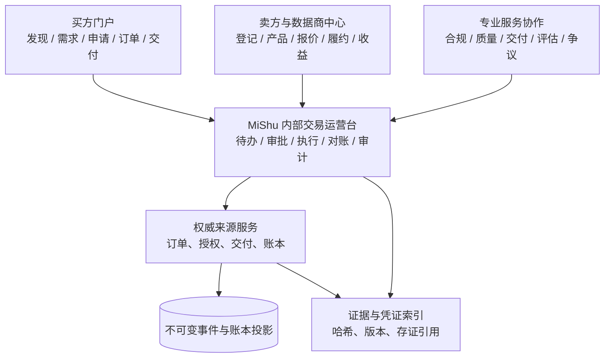

# 城市数据交易所深度比较与 MiShu 平台目标形态

调研日期：2026-11-04。本文聚焦上海、深圳、北京、杭州、广州、贵阳、重庆等城市（或区域）数据交易场所，回答两个问题：这些交易场所分别解决什么问题，以及 MiShu 交易管理平台应当建设成什么样子。

本文使用公开官方法规、政府网站、交易所官网和公开业务规则。没有把公开宣传页当作实际操作证据，也没有登录企业客户工作区、提交真实挂牌申请或进行真实支付。结论分为两类：

- **资料事实**：由链接所指的官方资料直接支持；
- **MiShu 设计推导**：结合 MiShu 当前代码、独立仓库边界和真实交易管理需求形成的产品建议。

## 1. 先给结论

MiShu 不应先做一个“把各城市交易所首页拼在一起”的商城。更合适的目标是：

> 一个以交易事件、合规证据、交付履约、结算对账和岗位待办为核心的交易运营平台；在此基础上，再提供面向买方、卖方和服务机构的产品市场与协作门户。

七个城市的公开规则虽然名称不同，但都反复出现同一条主线：

```text
主体入场
  → 数据资源/产品登记
  → 合规与质量评估
  → 产品挂牌或服务发布
  → 需求匹配、询价、磋商
  → 合同与授权
  → 安全交付或可信计算
  → 清分结算
  → 交易凭证/存证
  → 纠纷、撤权、续期与监管
```

这条主线对 MiShu 的直接要求是：

1. **交易对象不能只建一个订单表。** 至少要区分交易主体、数据资源、数据产品版本、挂牌、需求/申请、合同授权、交付任务、结算批次、交易凭证和争议案件。
2. **后台首屏应该是待办和风险，而不是所有角色相同的大盘。** 运营、合规、审批、交付、结算、审计和系统管理员需要不同工作区；同一订单详情可按字段和动作授权复用。
3. **审批、执行、交付、结算、凭证必须是不同状态。** “审批通过”不能显示成“交易完成”；来源回执、投影同步和对账完成也必须分开。
4. **合规不是一个布尔字段。** 应记录数据来源、主体资质、授权范围、个人信息/重要数据判断、负面或谨慎清单命中、质量评估、风险接受、有效期和复核人。
5. **交付是受控履约。** 需要支持明文文件、API、结果集、可信执行环境、隐私计算、联合建模和“可用不可见”等不同方式；每种方式都应有交付前检查、计量、撤销和证据。
6. **区块链只做可信存证和凭证关联，不替代主账本。** 原始数据、订单和积分仍由权威来源服务保存；后台保存事件摘要、版本、哈希、时间和外部存证引用。
7. **价格发现和生态服务要逐步增加。** 报价、询价、议价、成本/价格参考、数据商、第三方合规机构和交付服务商应作为可扩展模块，不要在第一阶段假装所有交易都是标准电商下单。

## 2. 样本与证据边界

| 样本                     | 主要观察重点                                                           | 证据类型                                     |
| ------------------------ | ---------------------------------------------------------------------- | -------------------------------------------- |
| 上海数据交易所           | 全流程数字化、交易凭证、第三方结算、登记挂牌与交付规则                 | 上海市政府规章/办法、上海数据交易所制度页面  |
| 深圳数据交易所           | 交易阶段、负面/谨慎清单、产品质量、测试样例、第三方服务机构            | 深圳市政府管理办法及地方标准                 |
| 北京国际大数据交易所     | 权利分置、隐私计算、监管沙箱、所有权/使用权/收益权/跨境等模式          | 北京市政府及交易所公开资料                   |
| 杭州数据交易所           | “三数一链”、数据产权登记、数据试衣间、产品/场景/资源/企业市场          | 杭数所官网、杭州市及国家数据局公开资料       |
| 广州数据交易所           | “无场景不登记、无登记不交易、无合规不挂牌”、一所多基地多平台、隐私计算 | 广州市政府、国家发改委及公开报道             |
| 贵阳大数据交易所         | 规则体系、价格评估、数据商凭证、数据/算法/算力多类标的                 | 贵州省政府、贵阳交易所用户手册及公开政府报道 |
| 西部数据交易中心（重庆） | 数据产品与数字资产两条主线、汽车等产业专区、挂牌/交付/结算/存证        | 重庆市政府、重庆市大数据主管部门公开资料     |

城市样本不能代表每个交易场所当前全部可用功能。尤其是“支持隐私计算”“支持监管沙箱”“支持跨境”等表述，部分来自建设方案或历史政策，不能当作已向所有普通用户开放的现成功能。本文只将公开材料明确表达的业务方向用于产品设计启发。

## 3. 城市比较总表

| 城市/场所             | 业务重心                             | 公开流程或规则特征                                                                                                                                                                                                                                                                                                                     | 对后台最有价值的借鉴                                                                     | 不能直接照搬的地方                                                                             |
| --------------------- | ------------------------------------ | -------------------------------------------------------------------------------------------------------------------------------------------------------------------------------------------------------------------------------------------------------------------------------------------------------------------------------------- | ---------------------------------------------------------------------------------------- | ---------------------------------------------------------------------------------------------- |
| 上海                  | 标准化、全数字化、交易凭证与清结算   | 登记、挂牌、询价、签约、结算、交付、交易管理和专业服务全流程线上化；实行第三方结算和客户分账管理；交易完成后可发交易凭证。[上海市管理办法](https://www.shanghai.gov.cn/202312bmgfxwj/20230712/8b5212a60a8e4360ac6dcf722591e554.html)                                                                                                   | 把交易拆成可审计阶段；结算与交易平台职责分开；用交易凭证收束完整证据链                   | 上海规则面向具有机构资质的场内数据交易，MiShu 的积分交易和数字内容售后不能直接套用产品挂牌规则 |
| 深圳                  | 合规审查、安全交付、场景化撮合       | 明确交易准备、磋商、合同、交付结算、争议处理；要求质量评估、合规指南、负面清单和谨慎清单；要求交付安全和测试样例环境。[深圳市管理办法](https://www.sz.gov.cn/cn/xxgk/zfxxgj/zcfg/content/post_10454883.html)、[交易流程条款](https://www.deo.org.cn/article/sjjy_sjbzlx/detail575.html)                                                | 建立规则引擎和清单命中；在正式购买前提供受控测试；把第三方合规和交付服务商纳入流程       | 负面/谨慎清单需要法务和数据分类基础，不能只做一个前端下拉框                                    |
| 北京                  | 权利分置、隐私计算和多种交易模式探索 | 公开方案提出用隐私计算、区块链分离所有权、使用权、隐私权，并探索所有权、使用权、收益权和跨境交易等类型。[北京市政府资料](https://data.beijing.gov.cn/xydt/ljhd/zllqjsbjgjdsjjyscl/index.htm)、[交易所方向](https://www.deo.org.cn/article/sjjy_jysgg/detail89.html)                                                                    | 把“买数据”改为“获得特定用途、期限、范围的使用授权”；在产品目录中显示权利和限制           | 部分资料是早期建设方案或研究方向；MiShu 不应虚构跨境、收益权或监管沙箱交易能力                 |
| 杭州                  | 公共数据授权、产权登记和场景化市场   | 官网列出登记、挂牌、测试、撮合、交付、结算、凭证、纠纷；商城采用“数场景、数资源、数商品、数企业、数政策”；国家数据局资料提到存证登记、合规审核、供需撮合、交易备案、清分结算闭环。[杭数所官网](https://www.hzdex.cn/)、[国家数据局案例](https://www.nda.gov.cn/sjj/ywpd/szjj/1213/20240902173516653398839_pc.html)                     | 以场景和需求组织目录；把产权/资产登记与交易过程连起来；提供交易前测试或“数据试衣间”      | “登记”是证据和服务，不自动等于质量保证、法律确权或交易完成                                     |
| 广州                  | 场景牵引、合规登记、生态服务         | 强调“无场景不登记、无登记不交易、无合规不挂牌”；建设登记、交易、监管平台；交易标的覆盖数据产品、服务、能力和数字资产；采用隐私计算实现可用不可见、可控可计量。[国家发改委](https://www.ndrc.gov.cn/fggz/tzgg/dfggjx/202211/t20221101_1340659.html)、[广州市政务答复](https://zsj.gz.gov.cn/zwgk/zfxxgj/zcfg/content/post_9676432.html) | 让业务场景成为挂牌和合规的必填上下文；为数据托管、保险、融资、培训等第三方服务预留协作位 | “一所多基地多平台”是生态与组织模式，不能简单变成 MiShu 的多套相互孤立后台                      |
| 贵阳                  | 规则体系、价格评估和多元标的         | 发布流通、成本/价格/资产价值、合规、安全、数据商准入等规则；用户手册覆盖数据产品、数据资源、算法模型、算力资源登记后上架；强调可用不可见、可控可计量。[贵州省管理办法](https://www.deo.org.cn/article/sjjy_sjbzlx/detail339.html)、[用户手册](https://gzswj.guizhou.gov.cn/swgz/202408/P020240826401256928079.pdf)                     | 把产品准入、价格参考、数据商资格和算力/算法等非数据集标的纳入统一工单                    | 价格计算器只能提供参考区间，不能替平台自动决定交易价格或收益分配                               |
| 重庆/西部数据交易中心 | 产业专区、数据产品和数字资产         | 以数据产品交易和数字资产交易为两条主线，围绕确权、定价、互信、入场、监管；公开资料提到持续完善上架挂牌、交付结算、交易存证制度，并发展汽车等行业专区。[重庆国资委](https://gzw.cq.gov.cn/gqzp/202405/t20240530_13249774_wap.html)、[重庆市大数据局](https://dsjj.cq.gov.cn/zwgk_533/jyta/202606/t20260609_15739076_wap.html)           | 用行业专区、产品类型和存证规则组织运营；把融资、质押和重复质押风险作为资产服务扩展点     | 数字资产、质押和跨区域服务会引入金融和法律风险；MiShu 首期先做可核验交易事实和积分账本         |

国家数据局推动的 24 家交易机构互认互通倡议，已把北京、上海、深圳、杭州、广州、贵阳、西部数据交易中心等纳入共同参与者，并提出在质量评估、产品交付、纠纷协调、术语、接口、交易流程和安全防护方面加强标准互认。[国家数据局倡议](https://www.nda.gov.cn/sjj/zhuanti/ztszzh/0902/20240830165252149196874_pc.html) 这意味着 MiShu 的数据模型和事件接口不应只为某一个页面服务，应保留跨平台的产品、授权、交付和凭证映射能力。

## 4. 七个城市分别告诉我们什么

### 4.1 上海：把“交易完成”定义成一组可验证条件

上海公开管理办法最适合用来定义 MiShu 的状态边界。它把数据产品登记、挂牌、交易签约、资金结算、交易凭证、信息披露和纠纷调解列为交易场所服务，并要求登记、挂牌、询价、签约、结算、交付和管理服务全过程数字化；还要求交易资金由第三方银行或支付机构结算，按客户分账管理。[上海市管理办法](https://www.shanghai.gov.cn/202312bmgfxwj/20230712/8b5212a60a8e4360ac6dcf722591e554.html)

MiShu 应因此把一个订单的“完成”拆成至少五个可核验门槛：

1. 合同/授权成立；
2. 来源服务已执行；
3. 交付方和需求方确认交付，或可信计算结果已生成；
4. 结算和分账分录已由权威账本写入；
5. 对账通过，交易凭证可以生成。

内部后台要同时显示“审批状态、来源执行状态、交付状态、结算状态、凭证状态、同步状态”，而不是只显示一个 `status=completed`。

### 4.2 深圳：合规规则必须进入产品和工作流

深圳规则把产品质量评估、合规审核指南、负面清单和谨慎清单明确为交易场所运营要求；交易准备阶段还要求卖方披露产品描述、适用范围、更新频率、计费方式并提供产品或服务样例，平台应提供在线撮合和受控测试样例环境。[深圳市管理办法](https://www.sz.gov.cn/cn/xxgk/zfxxgj/zcfg/content/post_10454883.html)、[深圳交易流程条款](https://www.deo.org.cn/article/sjjy_sjbzlx/detail575.html)

这对应 MiShu 的三个产品能力：

- **产品合规档案**：以材料清单和审查意见驱动，不用一列 `compliance=true` 代替；
- **试用/测试沙盒**：限制数据字段、调用次数、下载和保存期限；
- **规则命中解释**：告诉运营人员命中了哪一条清单、缺哪项材料、由谁复核、下一步是什么。

受控测试还应有单独的计量和审计事件。测试成功不能直接授予正式交付权限。

### 4.3 北京：交易标的是“权利和用途”，不是一份裸文件

北京市政府公开资料把所有权、使用权、隐私权分离，以及隐私计算、区块链和监管沙箱作为建设方向；公开方案还将交易类型分成所有权、使用权、收益权和跨境交易等。[北京市政府资料](https://data.beijing.gov.cn/xydt/ljhd/zllqjsbjgjdsjjyscl/index.htm)

即使 MiShu 不直接建设收益权或跨境交易，也应该在产品和授权模型中保留：

- 权利类型：持有、加工、经营、使用或结果使用；
- 使用目的和业务场景；
- 可用字段、地域、主体、调用频次和期限；
- 是否允许再加工、再授权、下载或导出；
- 交付的是原始数据、派生结果、模型、接口还是计算结果。

这样才能解释“买到了什么”，也能在撤权、退款、投诉和审计时核对实际承诺。

### 4.4 杭州：目录必须围绕场景和生命周期

杭州官网把数据交易、产权登记、产品挂牌、交易测试、撮合、数据交付、产品交付、资金结算、凭证发放和纠纷处理放在同一套基础设施叙事中；商城又把入口拆成数场景、数资源、数商品、数企业和数政策。[杭数所官网](https://www.hzdex.cn/)、[杭州商城](https://mall.hzdex.cn/)

国家数据局对杭州“数谷”案例的描述还强调存证登记、合规审核监管、供需撮合、交易备案、清分结算和数字证书等闭环服务。[国家数据局案例](https://www.nda.gov.cn/sjj/ywpd/szjj/1213/20240902173516653398839_pc.html)

MiShu 的目录不应只有“按商品名称搜索”。推荐同时提供：

- 场景入口：金融风控、内容生成、城市治理、营销、科研等；
- 产品入口：数据集、API、报告、模型、算法、算力、计算服务；
- 供方与服务商入口：供数方、数据商、合规机构、交付机构；
- 生命周期入口：登记、上架、试用、交易中、交付、续期、撤销、归档。

“数据试衣间”类能力可以先做成受控样例和价值评估任务，不需要第一阶段建设完整隐私计算平台。

### 4.5 广州：没有场景就不应该允许直接上架

广州公开政策最值得借鉴的是业务门槛表达：“无场景不登记、无登记不交易、无合规不挂牌”。其平台架构区分登记平台、交易平台和监管平台，并支持数据产品、数据服务、数据能力和数字资产等标的；通过隐私计算实现数据不出域、可用不可见和可控可计量。[国家发改委](https://www.ndrc.gov.cn/fggz/tzgg/dfggjx/202211/t20221101_1340659.html)

MiShu 可以把“场景”设计为一等对象：

- 场景目标和业务负责人；
- 输入数据和最小必要字段；
- 产出物与验收指标；
- 合法性和授权依据；
- 预计使用期限和参与方；
- 失败、撤回和争议处理方式。

产品只有绑定一个获批准的场景，才能进入挂牌/交易状态。这样可以减少“有数据但没有合理使用目的”的产品堆积。

### 4.6 贵阳：规则、定价和生态是平台能力，不是备注字段

贵州公开资料显示，贵阳大数据交易所围绕确权、定价、合规审查、安全评估、数据商准入等方向形成规则体系；用户手册把数据产品、数据资源、算法模型和算力资源纳入登记后上架流程。[贵州省管理办法](https://www.deo.org.cn/article/sjjy_sjbzlx/detail339.html)、[贵阳用户手册](https://gzswj.guizhou.gov.cn/swgz/202408/P020240826401256928079.pdf)

对 MiShu 的启发是把三类对象分开：

- **交易产品**：可以被购买、订阅或授权的标的；
- **支撑资源**：数据集、算力、算法、接口和存储等资源；
- **专业服务**：合规、评估、清洗、交付、审计、保险、融资和争议调解。

价格可以先支持固定价、按次、按量、订阅、面议和报价/议价六种模式；另设价格参考任务，记录成本、历史成交、质量、时效和使用范围。平台不得用一个自动估值替代供需双方和合规人员的判断。

### 4.7 重庆：行业专区要能沉淀行业规则

西部数据交易中心公开定位包含数据产品交易服务、数字资产交易服务和实体经济赋能，并持续完善产品上架挂牌、交付结算、交易存证制度；重庆的公开材料还提到汽车等行业专区和数据资产质押中的重复质押风险。[重庆国资委](https://gzw.cq.gov.cn/gqzp/202405/t20240530_13249774_wap.html)、[重庆市大数据局](https://dsjj.cq.gov.cn/zwgk_533/jyta/202606/t20260609_15738976_wap.html)

MiShu 应允许“应用/行业专区”挂接自己的字段、审核表、交付方式和价格模型，但底层仍使用统一事件、授权和审计模型。行业专区可以扩展规则，不能绕过统一的主体准入、双人审批、账本和来源校验。

## 5. MiShu 应该做成什么样

### 5.1 两个产品面、一个事实内核

建议的目标形态如下：



“两个产品面”指外部交易门户和内部运营台；它们共享身份、产品、订单、授权和事件的事实内核，但外部主体不能通过内部岗位权限进入运营台。MiShu 当前应先改造内部运营台，外部门户和真实数据产品交易作为后续阶段。

### 5.2 外部交易门户

外部门户未来应该支持：

1. 主体注册、企业认证、数据商/服务商资质和授权代表；
2. 场景、产品、服务商和行业专区的发现；
3. 产品说明书、版本、质量与合规材料摘要；
4. 需求发布、询价、报价、议价和受控样例测试；
5. 合同、授权、使用期限、区域、字段和计量规则确认；
6. API、文件、结果集、可信计算或隐私计算交付；
7. 订单、交付、续期、撤销、退款/争议和交易凭证；
8. 买方、卖方、数据商和第三方服务机构的分账与收益查询。

它不是当前五个内部员工账号的替代品。外部组织账号、组织成员和内部操作员必须分别建模。

### 5.3 内部交易运营台

内部后台应围绕八个工作台组织：

| 工作台         | 主要问题                           | 典型输出                         |
| -------------- | ---------------------------------- | -------------------------------- |
| 主体与产品准入 | 谁能进场，产品是否可以进入下一阶段 | 认证档案、材料缺口、准入决定     |
| 合规与质量     | 为什么通过/拒绝，依据是什么        | 评估表、清单命中、意见、复核期限 |
| 交易与合同     | 谁和谁就什么用途达成了什么约定     | 需求、报价、合同、授权快照       |
| 交付与计量     | 交付了什么，是否按约可用           | 交付任务、访问记录、验收、撤权   |
| 结算与分账     | 应收、应付、平台费和版税是否一致   | 账单、清分批次、对账差异         |
| 凭证与存证     | 如何向交易方和监管方解释一笔交易   | 交易凭证、哈希、时间线、存证引用 |
| 争议与异常     | 失败、撤权、超时和投诉如何收口     | 工单、证据包、处理决定、通知     |
| 规则与审计     | 谁改了规则和权限，影响了哪些交易   | 版本化规则、审计日志、影响分析   |

每个工作台都应有“待我处理、我发起的、即将超时、需要补证据、异常/差异、最近完成”几类队列，而不是只给一个总数卡片。

## 6. MiShu 的角色与权限设计

### 6.1 内部岗位建议

当前五岗位可以沿用，但应从“页面角色”升级为“任务能力模板”：

| 岗位       | 默认首页                   | 可以做什么                                       | 明确不能做什么                                         |
| ---------- | -------------------------- | ------------------------------------------------ | ------------------------------------------------------ |
| 系统管理员 | 人员、应用、接入和安全     | 管理账号、应用范围、服务凭证、规则配置、系统诊断 | 不因管理员身份自动获得退款审批、账本写入或来源命令权限 |
| 运营处理   | 交易、主体、产品、异常队列 | 查单、建工单、补证据、发起受控申请、跟进交付     | 不能审批自己发起的申请，不能直接改来源事实             |
| 独立审批   | 待审批和影响评估           | 审批/拒绝授权范围内的申请，查看影响和证据        | 不能审批本人申请，不能绕过来源状态和命令幂等           |
| 运营查看   | 查询、报表和有限详情       | 查询已授权数据、查看状态、使用获批报表           | 默认不应隐含审批、执行、成员管理或批量导出             |
| 审计       | 审计、凭证、对账差异       | 查完整证据、导出审计范围、查看变更和存证         | 不能改变业务状态或替代审批人                           |

这些岗位仍然只是默认模板。最终授权应是：`能力 × 应用/环境 × 对象范围 × 状态条件 × 字段/导出策略`。外部买家、卖家、数据商和专业服务机构不应复用这五个岗位。

### 6.2 必须支持的权限粒度

- 页面/路由：是否能看到工作台；
- API 动作：查看、申请、审批、拒绝、执行、撤销、导出、配置；
- 对象范围：应用、环境、行业专区、组织、产品、订单和案件；
- 字段范围：个人信息、商业秘密、价格、成本、合同附件和审计证据；
- 状态条件：只有待审、未交付、授权有效且来源版本匹配时才能执行；
- 时间条件：审批有效期、访问期限、下载有效期和复核期限；
- 组合约束：双人审批、申请人不得自批、敏感数据需额外复核。

菜单隐藏只能改善体验，不能作为安全边界。后端查询、详情聚合、异步导出、下载和来源命令都必须重复校验。

## 7. 必须建设的功能清单

### P0：先让交易可解释、可控制、可核对

1. **主体与组织管理**：组织认证、成员、授权代表、数据商/服务商类型、资质有效期、停用和复核。
2. **产品登记与版本**：产品类型、数据来源、权利类型、场景、版本、更新频率、样例、交付方式、价格模式和材料清单。
3. **合规与质量工作流**：主体合规、标的合规、流通合规、质量评估、负面/谨慎清单、材料补交、复核和有效期。
4. **需求、报价与合同**：需求发布、供需匹配、报价/议价记录、合同模板、授权范围和不可变快照。
5. **交易状态机**：登记、待审、已挂牌、磋商中、待签约、已签约、待交付、交付中、待验收、待结算、已结算、已凭证、争议、撤销、过期等状态分离。
6. **交付任务**：文件、API、结果集、可信环境和隐私计算等方式；交付前检查、访问计量、验收、失败重试、撤权和证据。
7. **结算、分账与对账**：第三方结算适配、客户分账、平台费/供方收益/版税/服务费、整数精度、清分批次、异常差异和冲正。
8. **证据链与凭证**：对象版本、内容摘要、事件时间线、来源回执、交付确认、结算引用、哈希和外部存证编号。
9. **五岗位工作区**：不同首屏、菜单、队列、字段和动作；统一登录、独立账号、服务器端授权。
10. **异常与争议**：执行未知、交付失败、撤权、数据质量投诉、超时、重复命令、权限冲突、对账差异和证据包。

### P1：提高成交效率和规模化运营能力

1. 受控样例、沙盒、数据试衣间和试用计量；
2. 价格参考、历史成交统计、报价/议价和行业专区；
3. 数据商、合规机构、交付服务商和争议调解机构目录；
4. 产品检索、场景导航、企业图谱、数据血缘和关系图；
5. 通知、超时升级、保存视图、批量补证和批量审批（仍受双人约束）；
6. 交易凭证在线验真、对外分享、下载水印和字段脱敏；
7. 跨交易所/跨应用产品、合同、授权和凭证映射；
8. 规则版本、清单版本和规则变更影响分析。

### P2：在规则和来源成熟后扩展

1. 隐私计算、联邦学习、可信执行环境和跨域数据空间编排；
2. 数据资产入表、质押融资、保险、信托和收益权等金融服务；
3. 跨境交易、跨区域互认、跨链存证和多地结算；
4. 买方/卖方自助门户、开放 API、订阅计量和自动续期；
5. 可配置行业工作流和组织级自定义角色。

P2 功能都需要独立的法律、来源服务、清算和安全评估，不能因为门户上放了一个按钮就当作已经具备能力。

## 8. 建议的数据模型和状态边界

### 8.1 核心实体

```text
party / organization / member
  ├─ credential / qualification / authorization
  ├─ scenario
  ├─ data_resource
  ├─ product ─ product_version ─ listing
  ├─ demand / quote / negotiation
  ├─ contract ─ entitlement
  ├─ order ─ delivery_task ─ usage_meter
  ├─ settlement_batch ─ allocation ─ journal_reference
  ├─ certificate ─ evidence_record ─ external_attestation
  └─ dispute / operation_request / approval / audit_event
```

`product` 是可理解的产品身份，`product_version` 是交易时看到的具体内容，`listing` 是在某个场景、专区、交易所和时间范围内的可售/可订阅条目。订单必须引用版本和授权快照，不能随着产品更新而改变历史承诺。

### 8.2 事件与权威边界

- 来源服务继续拥有订单、资产归属、实际授权、交付事实和积分账本；
- MiShu 保存查询投影、管理申请、审批、同步进度、对账和审计；
- 事件至少带有 `event_id`、`schema_version`、`source_cursor`、`source_version`、`occurred_at`、对象范围和内容摘要；
- 真实来源命令必须使用独立凭证、明确启用开关、双人审批、`command_id` 幂等和来源事务校验；
- 任何修正都追加冲正或新的权威事件，不覆盖原记录；
- 订单、积分、结算和凭证的“成功”均以相应来源事件及对账条件确认，不能由前端按钮决定。

### 8.3 最小交易状态机

```text
REGISTERED
  → COMPLIANCE_REVIEW
  → QUALITY_REVIEW
  → LISTED
  → NEGOTIATING
  → CONTRACTED
  → DELIVERY_PENDING
  → DELIVERING
  → ACCEPTANCE_PENDING
  → SETTLEMENT_PENDING
  → SETTLED
  → CERTIFIED
```

每个主状态都允许明确的失败或终止分支：`REJECTED`、`WITHDRAWN`、`EXPIRED`、`DELIVERY_FAILED`、`REVOKED`、`DISPUTED`、`EXECUTION_UNKNOWN`。状态转换需记录触发人、规则版本、输入版本、证据和下一步；不要用大量互相矛盾的布尔字段取代状态机。

## 9. 区块链、凭证和审计如何落地

城市交易所普遍把区块链用于交易记录、产品版本、交付、清结算和凭证存证。上海公开报道提到，交易链把订单、交付信息和清结算信息上链，并为交易凭证生成唯一数字标识。[上海数据交易链报道](https://paper.people.com.cn/hwbwap/html/2023-03/20/content_25971000.htm) 杭州官网也明确写出将数据、交易记录和数据产权存入区块链，采用“一数一码”。[杭州数据交易所官网](https://www.hzdex.cn/)

MiShu 应采用“链下事实、链上/外部存证”的分层方式：

1. 原始交易、账户和文件留在权威来源或受控存储；
2. 后台保存不可变事件和证据索引；
3. 对产品版本、授权快照、合同、交付回执、结算批次和凭证生成内容摘要；
4. 将摘要、时间、对象标识和规则版本写入可信存证服务；
5. 对外发放可验真的凭证，显示交易编号、版本、范围、时间和状态；
6. 任何撤销、冲正、退款和争议都生成新的事件并关联旧凭证。

区块链不能证明数据来源合法、质量合格或真实履约，因此不能替代主体认证、合规审查、质量检测、交付验收和对账。

## 10. 对 MiShu 现有后台的改造计划

### 第 0 阶段：先修正边界和术语

- 明确 MiShu 首期仍是内部交易运营后台，不把公开市场能力误放到现有账号；
- 建立 `trade / product / authorization / delivery / settlement / evidence` 术语表；
- 明确模拟支付、积分和未来真实货币字段的展示规则；
- 由来源服务确认哪些对象和命令是权威事实；
- 写出五岗位的动作、字段、导出和对象范围矩阵。

### 第 1 阶段：P0 内部交易运营闭环

- 五岗位首屏、菜单、待办、详情字段和 API 授权统一；
- 订单详情加入申请、审批、来源命令、交付、结算、同步和对账时间线；
- 将现有退款流程改为审批、执行、回执、投影和对账分段展示；
- 导出作为独立能力，支持字段范围、任务所有权、撤权和有效期校验；
- 增加异常工单类型：未知结果、交付失败、授权过期、投影落后、对账差异和证据缺口。

### 第 2 阶段：登记、产品和合规工作流

- 在只读来源契约明确后加入主体、产品版本、场景和材料对象；
- 合规/质量工作台支持材料清单、负面/谨慎清单、审查意见和复核期限；
- 先用受控样例和人工验收模拟“数据试衣间”，不直接引入真实隐私计算生产命令；
- 增加产品、授权和交付的历史快照。

### 第 3 阶段：外部门户和专业服务生态

- 买方、卖方、数据商和第三方机构建立独立组织身份；
- 建设供需大厅、报价/议价、合同、交付、凭证和争议自助入口；
- 接入真实支付、第三方结算、计量、续期和专业服务前，单独做来源和法律验收；
- 再考虑跨交易所互认、隐私计算、数据资产金融和跨境场景。

### 每阶段都必须通过的验收

1. 五岗位分别登录后首屏、菜单、计数、字段和动作不同，越权 API 和导出均拒绝；
2. 申请人不能审批自己的申请；多浏览器会话切换不共享缓存和权限；
3. 同一订单能区分审批、来源执行、交付、结算、凭证和同步状态；
4. 网络超时不会产生第二次来源业务变更；未知结果可按同一 `command_id` 查询恢复；
5. 账本和分账保持整数精度，历史分录不可覆盖；
6. 撤权、过期、失败和争议都有可理解的原因、负责人和下一步；
7. 对账使用完整截止位置；缺失数据时显示“不完整”，不能显示“通过”；
8. 证据包能从订单追到授权、交付、结算、凭证和审计事件。

## 11. 研究后的取舍

### 应该吸收

- 上海的分阶段全流程和第三方结算边界；
- 深圳的场景、样例、负面/谨慎清单和交付安全；
- 北京的权利/用途分置和隐私计算思路；
- 杭州的场景化目录、产权登记、测试和凭证；
- 广州的“无场景、无登记、无合规”三道门槛；
- 贵阳的规则、价格参考、数据商和算法/算力标的；
- 重庆的行业专区、数据资产服务和交易存证；
- 国家数据局推动的术语、接口、交付和纠纷互认方向。

### 不应该直接照搬

- 把交易所门户的外部主体身份直接当作内部员工账号；
- 把“登记证书”当作法律确权、质量保证或交易完成；
- 把所有交易都设计成一次性文件下载；
- 把区块链当成第二本账或让后台直接修改链上/来源事实；
- 把价格计算器当成自动定价和收益分配系统；
- 把隐私计算、跨境、收益权和资产质押作为首期可执行功能；
- 用相同首页、相同聚合接口和隐藏按钮代替真正的权限隔离。

这份比较报告的最终建议是：MiShu 先做“可解释、可审计、可恢复”的交易运营内核，再做“可发现、可试用、可授权、可计量”的产品市场。顺序反过来，会先得到一个看起来丰富、但无法解释交易状态和责任边界的商城。
