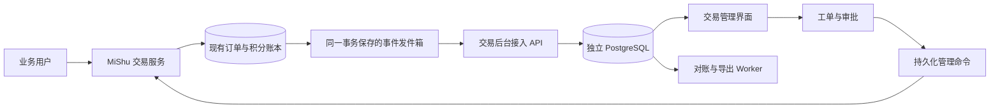

# 交易后台独立系统实施方案

- **小组**：前后端。
- **日期**：2026-10-23。
- **状态**：已启动；当前交付范围见 README.md 与 docs/acceptance.md。
- **目标仓库**：`mishu-trade-admin`，独立 Git 仓库，建议使用 GitHub 私有仓库。
- **适用范围**：MiShu 资产交易、积分账户、生成任务扣费和相关运营处理。
- **关联 Issue**：开发启动时建立。

首期建设独立部署的交易管理后台，集中提供订单查询、积分流水、分账核对、对账、异常工单、审批和导出。主平台现有交易服务继续作为订单、资产归属和积分余额的权威来源；新后台通过接口获取数据、发起受控操作，不直接连接或修改主平台数据库。

首期按“独立运行 → 真实数据只读接入 → 受控管理操作”逐步交付。后台可用不依赖 Prompt 审核服务，也不要求立即迁移现有交易引擎。

## 1. 负责的环节与现有基础

### 1.1 要解决的问题

运营需要统一查到一笔交易的买卖双方、资产、托管积分、交付结果、分账明细及异常原因；核对订单与流水，处理允许人工介入的未完成订单，并保留完整操作依据。管理人员不应通过直接修改数据库来解决交易问题。

系统同时支持多个业务应用接入，以应用和环境划分数据范围。当前 MiShu 是首个接入方，后续业务不需要共享它的代码库、数据库或用户登录 Session。

### 1.2 当前代码能力

| 现有能力                               | 代码位置                                                            | 对本方案的影响                                             |
| -------------------------------------- | ------------------------------------------------------------------- | ---------------------------------------------------------- |
| 下单、积分托管、交付、验收、结算、退款 | [交易服务](../../mishu-platform/apps/server/src/services/trades.ts) | 首期复用现有交易规则，新增管理入口不得绕过状态校验         |
| 平台服务费、二级版税和上游版税         | 同上                                                                | 导入实际记账结果，不依据当前费率重新计算历史收益           |
| 双向平衡的积分记账、余额和冻结账户     | [积分账本](../../mishu-platform/apps/server/src/wallet.ts)          | 原账本继续负责写入，新后台保存用于查询与核对的副本         |
| 充值和订阅                             | [钱包接口](../../mishu-platform/apps/server/src/routes/wallet.ts)   | 当前为模拟支付，不能展示为已真实收款                       |
| 生成任务积分冻结、结算和退回           | [生成任务服务](../../mishu-platform/apps/server/src/jobs.ts)        | 纳入积分流水查询，首期不通过后台直接重启生成或再次扣费     |
| 用户侧交易接口                         | [交易路由](../../mishu-platform/apps/server/src/routes/trades.ts)   | 当前基于买卖双方身份授权，不能拿管理员密钥直接替代用户调用 |
| SQLite 数据库和迁移                    | [数据库定义](../../mishu-platform/apps/server/src/db.ts)            | 接入方需要增加事件发件箱、管理命令记录和版本字段           |

现有交易主路径为 `CREATED → FUNDED → DELIVERED → COMPLETED`，其中下单会直接完成积分托管并持久化为 `FUNDED`。异常结果包括 `REFUNDED`、`RESOLVED_BUYER`、`RESOLVED_SELLER`。当前卖家超时未交付会自动退款，买家超时未验收会自动结算；争议按现有密码学证据流程自动裁决。

后台展示必须保留“模拟支付”“积分”“真实支付金额”的区别。已有充值流水中的套餐编号可能重复，不能用套餐编号或业务备注作为唯一交易编号；应使用来源系统的记账事务编号和分录编号。

### 1.3 首期范围

**首期交付：**

1. 独立后台、API、Worker、PostgreSQL、部署与恢复工具。
2. 应用接入、后台登录、应用范围授权、角色权限和操作审计。
3. 订单、资产摘要、积分账户、完整交易流水、分账及生成扣费查询。
4. 存量快照导入、增量事件同步、幂等处理、断点恢复和同步健康状态。
5. 差异对账、异常工单、申请与审批，以及受限的未交付订单全额退回托管积分。
6. 后台导出任务，支持大批量分包、进度、取消、重试和到期清理。
7. MiShu 联调适配、隔离环境测试和验收文档。

**后续独立规划：** 真实支付渠道、自动续费、提现、银行或渠道对账、发票、已结算交易售后、部分退款、人工积分调整、账户冻结、交易引擎整体迁移。首期保留扩展字段，不展示可以执行这些操作的虚假按钮。

## 2. 在现有架构中的位置

### 2.1 系统职责

| 系统            | 权威数据与职责                                                               | 与其他系统的关系                                 |
| --------------- | ---------------------------------------------------------------------------- | ------------------------------------------------ |
| MiShu 业务平台  | 用户、资产归属、订单、积分账本、交付校验、交易规则                           | 发布已提交的交易事件；校验并执行管理命令         |
| 交易管理后台    | 操作员、审批规则、处理工单、命令生命周期、同步进度、对账结果、审计、导出任务 | 通过 HTTP 接入业务系统；保存来源数据的查询副本   |
| Prompt 审核后台 | Prompt 留档、审核结论和复核记录                                              | 按已有业务编号关联查询，不参与积分记账或交易审批 |



图中的发件箱属于主平台数据库。订单变化、积分记账及对应事件必须一起提交或一起回滚；发送事件的网络请求在事务提交之后执行。后台暂时离线不会中断用户下单或正常结算，未发送事件会保留并重试。

### 2.2 唯一记账责任

首期后台数据库中的订单和账户余额是查询副本，实际变化仍由主平台交易服务执行。审批通过只代表允许尝试执行，不代表已经退款或完成交易。

后台禁止直接更新主平台 SQLite，禁止通过修改副本制造“退款成功”，也不保存买家私钥、资产解密密钥、完整密钥封装或资产明文。资产管理仅提供交易定位所需的编号、标题、类型及所有者等摘要。

如果以后把交易核心迁入新仓库，必须单独制定历史账本迁移、核对及写入切换方案。不得让两个系统同时管理同一账户或执行同一订单结算。

## 3. 后台页面与操作范围

| 页面           | 首期内容                                                       | 关键交互                                             |
| -------------- | -------------------------------------------------------------- | ---------------------------------------------------- |
| 工作概览       | 成交、退款、托管积分、服务费、版税及异常趋势                   | 支持应用、环境、日期筛选；显示统计口径和同步截止时间 |
| 全部订单       | 买卖双方、资产、价格、许可类型、交易状态、交付与验收期限       | 编号精确搜索、用户/资产筛选、日期范围、分页、导出    |
| 订单详情       | 状态时间线、托管、关联分录、分账、交付验证摘要、争议结果、工单 | 一页串联订单、账户流水和处理记录；显示数据版本及来源 |
| 积分账户       | 可用积分、交易托管、生成任务冻结、余额变化                     | 查看流水和异常标记，不提供直接修改余额的输入框       |
| 全部流水       | 充值、赠送、生成扣费、托管、销售所得、版税和退款               | 按记账事务展开所有分录；区分来源类型和计量单位       |
| 分账与版税     | 卖家所得、平台服务费、创作者及上游版税                         | 展示实际分录和可用的费率快照；历史字段缺失时明确标注 |
| 异常与审批     | 异常单、退款申请、审批、执行进度和结果                         | 理由必填，申请人与审批人分离，操作前展示预期影响     |
| 对账中心       | 规则、批次、截止位置、差异、认领与处理过程                     | 可重跑对账、补拉数据；修复查询副本不等于修改来源账本 |
| 导出中心       | 本人导出任务、文件、进度和有效期                               | 关闭页面后任务继续，支持取消、失败重试及分包下载     |
| 应用与系统管理 | 应用、服务凭证、操作员、权限、操作限额、审计                   | 按应用授权，凭证按用途分开，记录配置变更             |

界面沿用密树品牌、深浅主题、表格和表单风格，兼容桌面与手机。进行中的审批执行和导出自动刷新；隐藏标签页暂停页面轮询，后台任务继续运行。

订单、流水采用稳定排序及游标分页；常用列表可提供有限范围的页码跳转，百万级深页优先使用日期定位和游标。不得把页码乘偏移量作为所有大表查询的唯一实现。

## 4. 数据模型与记账口径

### 4.1 主要表

| 表或表组                                                         | 用途与约束                                                             |
| ---------------------------------------------------------------- | ---------------------------------------------------------------------- |
| `applications`、`service_credentials`                            | 应用、环境、接入地址与权限；入站凭证保存哈希，出站调用所需秘密加密保存 |
| `operators`、`roles`、`operator_scopes`、`sessions`              | 操作员、角色、应用范围、会话和二次认证状态                             |
| `event_inbox`、`sync_jobs`、`sync_checkpoints`                   | 入站事件、处理状态、重试、隔离队列和导入进度                           |
| `trade_projections`、`asset_summaries`、`job_charge_summaries`   | 订单及关联对象的查询副本，保存来源版本和同步时间                       |
| `account_projections`、`journal_transactions`、`journal_entries` | 积分账户及来源原始分录；分录按来源事务完整接收，禁止静默覆盖历史内容   |
| `settlement_items`                                               | 从实际记账分录映射卖家收入、服务费和版税，不生成第二份可写账本         |
| `operation_requests`、`approvals`、`command_attempts`            | 工单、审批快照、命令状态、尝试次数与执行回执                           |
| `reconciliation_runs`、`reconciliation_findings`                 | 对账截止位置、结果、差异与处置历史                                     |
| `export_jobs`、`audit_events`                                    | 导出任务和追加式操作审计                                               |

所有来源对象使用 `(application_id, environment, source_id)` 作为业务唯一范围。订单、记账事务和分录分别有独立编号；不能依赖订单号唯一约束替代分录去重。

### 4.2 金额与积分

- 积分使用整数；真实货币字段预留 `currency`、`amount_minor`，按最小货币单位保存。
- PostgreSQL 使用 `BIGINT` 等精确类型；跨 API 的金额、积分和大整数序号使用十进制字符串，避免 JavaScript 精度损失。
- `unit=CREDIT` 与货币单位分开核算，不合计成一个“总余额”。`payment_mode=simulated` 必须在相关页面和导出中保留。
- 来源数据记录为不可变分录。更正通过来源系统追加冲正与替代分录，再同步回来，不删除或覆盖历史分录。
- 账户副本保存余额、来源版本和截止位置；重新构建时从受验证的期初余额加后续分录计算。

### 4.3 分账与统计

单笔积分结算应满足：`托管释放 = 卖家所得 + 平台服务费 + 创作者版税 + 上游版税`。每个来源记账事务内，同一计量单位的分录有符号金额合计应为零。

后台使用来源系统实际入账金额，不用当前资产版税比例反推历史金额。接入后的事件保存结算时适用的规则版本、比例及实际分配；历史记录缺少比例或规则快照时保留“未记录”，不填入当前值冒充历史值。

概览按成交完成时间统计成交积分，按实际退款记账时间统计退款，托管积分属于时点余额；每项指标标明单位、是否包含模拟数据、所选时区及同步截止时间。历史售后冲正如果以后加入，应另列净额口径，不回写当时的成交记录。

## 5. 数据同步与历史导入

### 5.1 增量事件

每个事件包含 `event_id`、`schema_version`、`source_cursor`、`occurred_at`、对象编号及单调递增的对象版本。应用与环境由服务凭证确定，不能仅信任请求正文传入的应用编号。

事件类型覆盖交易托管、交付、结算、退款、争议结果，以及积分充值、赠送、生成冻结、生成结算和退回。涉及同一笔业务记账的事件应包含完整事务分录及关联订单变化，后台在一个本地事务中更新这些副本并标记事件完成。

接入方在业务事务中创建事件，Worker 至少发送一次，后台按唯一编号去重。同一编号、相同正文摘要视为重复；同一编号、不同摘要进入异常处理，不覆盖原事件。HTTP 成功仅表示已持久化接收，投影处理进度单独查询。

重试采用指数退避与抖动；达到上限后进入可见的隔离队列，由操作员处理原因后重放。后台用独立的“已接收”和“已应用”进度，不能把收到事件等同于账目已同步。

### 5.2 乱序与缺失

来源系统新增对象版本字段，不能只依赖毫秒时间戳判断先后。旧版本不覆盖新版本；对象版本出现缺口时暂缓相关更新，补拉缺失事件或请求权威快照。

分页游标只是来源位置，不要求相邻游标数字连续。同步完整性通过来源返回的覆盖区间、快照清单和已确认的检查点判断；对已过保留期、无法补拉的区间重新执行快照同步，不静默跳过。

普通查询可显示上次成功同步的数据，并注明延迟。对账必须使用覆盖完整、可比较的截止位置；缺少分录或快照的批次显示“数据不完整”，不能报告“对账通过”。

### 5.3 存量导入

1. 先启用可靠的事件发件箱，再创建来源快照任务。
2. 在来源系统的一致性快照中同时确定数据及事件截止位置 `W`，生成可分页读取的不可变快照文件或快照表；不能连续分页读取正在变化的业务表来假装一致快照。
3. 快照包括订单、完整记账事务、分录、账户余额及必要资产摘要，附清单、条数和内容摘要。
4. 后台导入到暂存区，核验数据、单位、唯一性及余额，导入成功后再开放查询。
5. 从 `W` 之后补消费事件，追平后切换到持续同步。导入期间事件保留期必须覆盖该任务，过期则重新生成快照。
6. 失败可断点续传；未通过验证的半成品不可成为正式余额或订单视图。

默认导入完整历史。如果后续按日期裁剪历史，应同时提供经过验证的期初余额，并在界面明确可追溯的起始日期；不能根据部分流水声称核对了全历史账本。

## 6. 管理操作与审批

### 6.1 首期允许的写操作

| 操作                                   | 首期处理方式                                                      |
| -------------------------------------- | ----------------------------------------------------------------- |
| 创建、认领、补充或关闭异常工单         | 后台内部操作，记录理由和审计                                      |
| 重试同步、重新执行对账、重建查询副本   | 操作员权限控制；不触发来源系统再次扣款或结算                      |
| 未交付订单全额退回托管积分             | 审批后请求来源执行；仅限来源仍为 `FUNDED`、尚未交付且无争议的订单 |
| 已交付、已结算或争议中的人工退款       | 首期不开放；需要另行设计交付权益、资产归属、版税追回和售后规则    |
| 手工加减积分、强制结算、修改资产所有者 | 首期不开放                                                        |

现有来源 `refundTrade` 内部允许更宽的状态范围。新的管理接口必须额外施加上述业务限制，不能直接暴露内部函数。原有自动超时处理和证据裁决继续按原业务规则运行，后台主要展示与核对其结果。

### 6.2 工单流程

工单主状态为 `draft → pending_approval → approved → executing → succeeded`，另有 `rejected`、`canceled`、`expired`、`execution_unknown`、`execution_failed`。技术重试不重新创建业务退款。

1. 申请人选择订单，填写原因；服务端从来源取得最新状态、版本、托管积分和退款对象，形成不可变的申请快照及内容摘要。
2. 另一位具备审批权限、且有相应应用范围的操作员查看影响并审批。申请人与审批人不能是同一个人；修改申请内容会使原审批失效。
3. 审批记录绑定申请摘要、金额、对象版本和有效期，建议默认 30 分钟内执行，超时重新核验并申请。
4. Worker 在发送前重新检查操作员资格、应用权限、审批有效性和来源最新状态；来源执行时再次检查条件。
5. 来源持久化执行结果；后台读取回执和同步事件后展示完成。若命令回执已成功、列表事件尚未同步，显示“执行成功，数据同步中”，不能再次发起退款。

### 6.3 防止重复执行和竞态

每次已批准业务操作对应唯一 `command_id`，同一命令的每次网络重试使用同一个编号和参数摘要。来源的命令去重记录、订单状态校验、记账和状态变化必须处于同一数据库事务中。

来源管理接口接收 `expected_version`，并在执行事务内与订单当前版本比较；两个命令及原有自动超时任务发生竞争时，仅符合条件的一次操作能完成。订单已经被其他路径退款时返回明确原因及已有退款关联编号，不把本次命令伪装成一次新的成功退款。

HTTP 超时、断网或 Worker 崩溃时进入 `execution_unknown`，先按原 `command_id` 查询结果；确认未执行且条件仍有效时，才能继续尝试同一命令。界面必须区分申请被拒绝、业务条件失效、执行结果未知和明确执行失败。

首期不新增“暂停自动结算”能力，人工申请本身不会冻结原交易流程。如果审批期间订单已经交付或状态改变，旧申请失效并提示重新核验。

## 7. 需要新增的接口与契约

以下为建议路径，最终在新仓库维护 OpenAPI 与事件 Schema；公共接入 API 与操作员管理 API 分开鉴权。

### 7.1 交易后台接入接口

| 接口                       | 类型      | 用途                                                   |
| -------------------------- | --------- | ------------------------------------------------------ |
| `POST /v1/events/batches`  | 新增 HTTP | 持久化接收事件批次，返回逐条接收结果；处理结果异步查询 |
| `GET /v1/events/:event_id` | 新增 HTTP | 查询接收、处理、失败与冲突状态                         |
| `POST /v1/imports`         | 新增 HTTP | 登记来源快照和清单，启动导入任务                       |
| `GET /v1/imports/:id`      | 新增 HTTP | 查询导入、校验和切换状态                               |
| `GET /v1/sync/status`      | 新增 HTTP | 获取当前应用已接收/已应用进度和缺口                    |

单批次建议起始限制为 100 个事件、2 MiB 正文；整笔记账事务不能拆成无法验证完整性的片段。超限的单事件通过受控导入任务处理，最终限制由真实载荷测试确定。

### 7.2 后台管理接口

| 接口组                                                                 | 用途                                     |
| ---------------------------------------------------------------------- | ---------------------------------------- |
| `/admin/overview`、`/admin/trades`、`/admin/trades/:id`                | 概览、订单列表与详情                     |
| `/admin/accounts`、`/admin/journal-transactions`、`/admin/settlements` | 账户、完整记账事务、分账                 |
| `/admin/operation-requests`                                            | 创建处理申请、查询记录；使用幂等请求编号 |
| `/admin/operation-requests/:id/approve`、`/reject`、`/cancel`          | 对指定版本的工单进行审批或取消           |
| `/admin/reconciliation-runs`、`/admin/reconciliation-findings`         | 发起对账、查询差异与处理记录             |
| `/admin/exports`                                                       | 创建、查询、取消、重试和下载导出任务     |
| `/admin/applications`、`/admin/operators`、`/admin/audit-events`       | 应用、人员、权限及审计                   |

列表查询支持应用、环境、状态、业务编号和日期范围。需要写操作的端点使用 POST，并校验 Session、CSRF、角色、数据范围及对象版本。

### 7.3 MiShu 接入适配接口

| 接口                                         | 类型      | 用途                                   |
| -------------------------------------------- | --------- | -------------------------------------- |
| `POST /internal/trade-admin/snapshots`       | 新增 HTTP | 创建一致快照任务，返回快照编号         |
| `GET /internal/trade-admin/snapshots/:id`    | 新增 HTTP | 查询清单、截止位置及授权下载信息       |
| `GET /internal/trade-admin/events?after=...` | 新增 HTTP | 按来源游标补拉事件                     |
| `GET /internal/trade-admin/trades/:id`       | 新增 HTTP | 操作前取得权威状态、版本与托管明细     |
| `POST /internal/trade-admin/commands`        | 新增 HTTP | 接收幂等管理命令，由交易服务验证并执行 |
| `GET /internal/trade-admin/commands/:id`     | 新增 HTTP | 查询权威执行结果，消除超时不确定性     |

内部接口使用单独的服务凭证和用途权限，不复用普通用户令牌，也不复用 Prompt 审核密钥。来源根据凭证限制可执行命令类型；管理网关只允许预配置的来源地址，不能由普通操作员任意填写内网 URL。

MiShu 联调分支在 `SPEC.md` 中补充对象版本、事件格式、管理命令前置条件、幂等规则及错误码；设计阶段不直接改动现有业务契约。

## 8. 对账与异常处理

首期对账针对内部积分数据，不等同于支付渠道或银行对账。对账批次绑定应用、环境、单位、规则版本和来源截止位置，使用与该位置一致的余额与分录。

| 对账规则                         | 发现的问题                   | 后续处理                                       |
| -------------------------------- | ---------------------------- | ---------------------------------------------- |
| 每个记账事务分录合计为零         | 丢失分录、错误金额或异常记账 | 先核验同步完整性，再检查来源事务               |
| 期初余额加后续分录等于账户余额   | 余额副本或来源账本不一致     | 对比来源快照；可重建副本，来源错误单独提交工单 |
| 托管订单与托管账户相符           | 漏冻结、重复释放、残留托管   | 关联订单、记账事务及执行命令调查               |
| 已结算订单存在完整分账，托管清零 | 漏结算、重复结算、分账不完整 | 生成差异项，不自动补发卖家收入或版税           |
| 已退款订单存在对应退回分录       | 订单与账本不一致             | 检查实际退款事务，禁止自动再次退款             |
| 生成任务冻结、结算、退回相符     | 重复扣费或冻结未释放         | 展示任务与流水，转业务处理工单                 |

对账任务定时运行并支持手动重跑；建议增量每 15 分钟、完整快照核对每日一次，按部署规模调整。差异项按业务对象和规则去重，后续复查追加结果；修复后保留原差异及处理依据。

## 9. 权限与安全

角色分为系统管理员、运营查看者、处理申请人、审批人和审计员。角色与应用范围分别授权；系统管理员可以管理账号及凭证，但不因此自动获得交易审批权。

涉及托管积分退回的操作必须由不同人员申请和审批，双方在执行前仍需拥有相应权限。启用真实来源写操作前，审批人员启用二次认证；缺少合格审批人时保留待处理状态，不自动绕过。

操作员使用 HttpOnly、SameSite Cookie 会话和 CSRF 防护；业务接入凭证按事件发送、快照读取、命令执行等用途分离，支持轮换与撤销。外部部署使用 HTTPS。不同应用、测试与正式环境的凭证、数据及命令执行开关隔离。

审计记录包括操作者、角色及应用范围、请求编号、对象版本、审批摘要、操作理由、执行回执和关键前后状态。普通后台接口不能修改或删除审计；数据库所有者仍有管理权限，这不等同于不可篡改存储。

不采集资产解密密钥和交易无关的 Prompt 原文。用户展示字段按角色脱敏；联系人等敏感信息按需加密，不把密钥或完整请求正文写入运行日志。备份密钥与数据备份分开保存。

## 10. 导出与容量设计

沿用审核后台已实现的导出交互，在新仓库独立实现和测试，不导入相邻仓库源码。

- 支持当前页、筛选结果、日期范围，以及摘要和明细字段选择。
- 订单、流水、分账、对账差异分别导出，文件中明确单位、环境、模拟标记及同步截止位置。
- 默认智能选择 Excel 或 JSONL 压缩分包，用户明确选 Excel 时保持 Excel 格式。
- 导出采用持久化后台任务，支持进度、取消、租约恢复、重试及原生分包下载。
- 任务与下载重新校验当前权限；含敏感明细的导出单独授权并记录审计。
- 初始配置建议每包最多 50,000 条或约 32 MiB 未压缩数据、单任务 2 GiB、文件保留 24 小时；超限提示缩小范围，不静默截断。并发和磁盘配额按实际数据测试调整。

来源记录和审计的留存期限与下载文件的有效期分开配置。首期不自动删除原始流水、审批和审计；后续清理规则需要考虑对账重建和历史追溯。

主要索引覆盖应用/环境/时间/编号、订单状态、账户与来源版本；事件按应用与来源编号唯一，分录按来源事务和分录编号唯一。统计使用可重建汇总表，大量查询不逐笔调用业务接口。

容量验收覆盖 10 万订单、100 万分录以及长字段和多分账场景；审核后台此前的导出测试结果不能直接作为交易后台的容量结论。记录测试机器、数据形状、查询延迟、Worker 吞吐、数据库负载及进程内存后再设上线阈值。

## 11. 新仓库与部署

```text
git/
├── mishu-platform/
├── mishu-prompt-guard/
└── mishu-trade-admin/
    ├── apps/admin/             React 管理界面
    ├── apps/api/               接入与管理 API
    ├── apps/worker/            同步 对账 命令执行 导出
    ├── packages/contracts/    OpenAPI 事件 Schema 状态定义
    ├── packages/core/         权限 工单 审批 对账规则
    ├── packages/database/     PostgreSQL 连接和事务
    ├── packages/adapters/     MiShu 与模拟来源适配器
    ├── migrations/
    ├── scripts/               本地启动 账号初始化 备份恢复
    ├── tests/
    ├── docs/
    ├── AGENTS.md
    ├── .env.example
    └── compose.yml
```

技术栈建议 React、TypeScript、Fastify、PostgreSQL，前期使用 PostgreSQL 持久化任务队列，无需先引入额外消息队列。队列任务使用租约、重试及失败隔离；互不相关的同步、命令与大文件导出分别限制并发。

本地建议预留 API/后台 8920、前端开发 8921、PostgreSQL 8922，启动前检查占用；端口为本方案建议值。配置包括 `DATABASE_URL`、加密密钥、来源地址、来源凭证和管理操作开关。`.env`、本地凭据、数据库、备份和导出文件全部忽略，示例配置只放占位值。

`SOURCE_MODE=mock` 只读取合成数据和模拟命令执行结果；`SOURCE_MODE=mishu` 接真实来源，默认只读，启用已实现的写操作必须单独配置。模拟应用与真实应用的数据不能混合展示为同一账本。

生产部署监测接收与应用延迟、隔离队列数量、未知结果命令、对账差异、导出磁盘和备份状态。API 存活不代表同步已追平，健康信息需分别报告。恢复演练应验证重新消费事件不会重复入账，恢复中的已批准命令不会未经结果查询便重复执行。

新仓库约定每次完成修改后验证并本地提交，后续按用户指定远程推送。界面规范在仓库内保存，避免运行时依赖 Prompt 审核仓库。

## 12. 主平台最小接入改动与协作依赖

主平台适配放在独立联调分支，业务系统接入包与后台仓库分别提交，不混入无关创作界面改动。

| 改动位置       | 必要改动                                                                   |
| -------------- | -------------------------------------------------------------------------- |
| 数据库迁移     | 事件发件箱、管理命令去重表、对象版本字段及索引                             |
| 交易与记账服务 | 在原事务内捕获记账事务编号、对象版本、实际分账与事件；盘点所有相关写入入口 |
| 新内部路由     | 快照、事件补拉、权威状态查询、受限退款命令和结果查询                       |
| 后台发送任务   | 提交后发送事件、重试、保留检查点和暴露积压指标                             |
| 配置与测试     | 服务凭证、接入开关、超时；原有交易与扣费流程回归                           |

单独开发新仓库可以先用模拟适配器完成全部页面与工单联调；真实数据同步和写操作必须完成以上改造，不能承诺零改动接管现有平台。

| 协作方                 | 提供内容                                                 | 所需阶段             |
| ---------------------- | -------------------------------------------------------- | -------------------- |
| 主平台后端             | 各记账入口、稳定业务编号、对象版本、事务事件及命令执行器 | 契约确定及真实接入前 |
| 前端与产品             | 查询筛选、详情字段、退款适用范围和角色流程               | 页面设计及审批实现前 |
| 交易与密码学模块维护者 | 交付/争议状态含义、允许人工介入的边界                    | 写操作开放前         |
| 运维                   | 部署环境、凭证管理、备份、告警和共享导出存储             | 联调和验收阶段       |

## 13. 实施阶段与验收

以下为开发工作量初步估算，不是固定上线日期；真实接入发现的数据缺口需单独评估。

| 阶段             | 交付                                                        | 验收条件                                                   | 估算     |
| ---------------- | ----------------------------------------------------------- | ---------------------------------------------------------- | -------- |
| A 契约与仓库基础 | 新仓库、Schema、权限框架、主题、本地部署、模拟来源          | 不启动主平台也能独立运行，权限和环境隔离可验证             | 3–4 人天 |
| B 查询与同步     | 订单/流水/账户/分账页面、存量导入、增量同步、MiShu 只读适配 | 存量与增量交界无漏数、重复或旧状态覆盖；来源与副本核对一致 | 5–7 人天 |
| C 对账与导出     | 对账规则、差异工单、异步导出与容量测试                      | 可识别预置差异，缺数据不误报通过，百万分录导出不截断       | 3–5 人天 |
| D 审批与命令     | 双人审批、受限退款、来源事务幂等、结果确认                  | 断网、重试、并发及重启均不重复退款；陈旧审批无法执行       | 5–7 人天 |
| E 验收与运行     | 端到端回归、备份恢复、操作手册和监控                        | 原交易流程回归通过，真实接入可追溯，故障恢复演练完成       | 3–4 人天 |

整体初步估算 19–27 人天；可以先交付 A–C 的只读管理版本，随后开放 D 中通过验证的写操作。

核心验收场景：

1. 跨应用、跨环境和越权查询、导出、审批、命令执行均被拒绝。
2. 来源业务事务回滚不发送成功事件；发送失败重试后仍只应用一次。
3. 重复事件、相同编号不同正文、乱序、缺口及过期游标均有确定处理结果。
4. 快照期间发生充值、下单、结算，导入加补消费后不丢失、不重复；半成品不开放。
5. 退款申请人与审批人相同、权限被撤销、审批过期、订单版本变化时不能执行。
6. 管理退款与自动超时退款、卖家交付并发，只允许满足业务条件的一方完成。
7. 来源执行后响应丢失、后台重启和备份恢复，通过原命令编号确认结果，不重复退款。
8. 退款或结算各分录守恒，托管归零，二级和上游版税与实际来源分录一致。
9. 缺少流水时对账显示不完整；注入真实差异后生成工单，不自动修改来源账本。
10. 导出覆盖筛选、日期、当前页、超限、权限收回、文件过期、取消和恢复；Excel 文本不作为公式执行。
11. 原有资产交付、许可签发、生成积分冻结和失败退回流程保持正确。
12. 大表查询、导出和恢复演练记录可复现；测试使用隔离数据库与合成数据。

## 14. 风险与待决事项

| 风险                       | 处理方式                                                                       |
| -------------------------- | ------------------------------------------------------------------------------ |
| 新旧系统分别修改余额       | 首期只允许来源服务记账；后台副本不能执行资金变化                               |
| 历史分账、充值上下文不完整 | 保存可验证的原分录与关联，标记缺失；不凭当前费率或套餐猜测历史                 |
| 未覆盖某个积分写入路径     | 盘点充值、订阅、赠送、生成、交易及内部任务入口，用完整对账和端到端测试验证覆盖 |
| 审批期间来源状态改变       | 申请版本绑定、执行前核验及来源事务条件检查                                     |
| 超时导致重复退款           | 持久化命令、来源事务幂等、原编号结果查询                                       |
| 长时间停机超出事件保留窗口 | 明确保留策略与告警，必要时重新建立一致快照                                     |
| 大量导出挤占交易资源       | 独立副本执行查询与导出，限流、分包、磁盘监测；控制来源快照创建成本             |

开发前采用的默认选择为：仓库名 `mishu-trade-admin`、首期覆盖资产交易和积分收支、真实来源先只读接入、人工操作仅开放已审批的未交付订单全额托管退款。真实支付、提现及交易核心迁移另立阶段。

进入写操作阶段前还需确定：哪些业务理由允许人工退款、各应用的单笔/每日操作额度、审批人员及权限分配、会话和二次认证要求、事件保留窗口、备份频率及恢复目标。这些配置不会阻止先开展独立仓库基础和只读查询开发。
